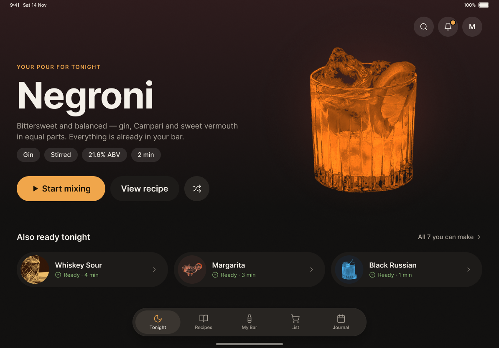

# Luceria Cocktail Atelier · iPad 应用设计

在 [drink-app](https://github.com/xmm-zy/drink-app) 的基础上重新设计的 iPad 调酒应用：先记下你家吧台有哪些酒，Luceria 告诉你今晚能调什么，再一步一步带你调出来。



- **平台**：iPadOS 横屏，画板 1194 × 834 pt（11" iPad）
- **语言**：界面全英文
- **风格**：深色为主；Inter 粗体；胶囊控件；满版 Hero，底色随饮品变化；底部悬浮标签栏
- **主题**：Dark、Light、High contrast，三种主题共用同一套 Figma 变量，只切换模式
- **设计源文件**：Figma 文件「Luceria Cocktail」，共 12 页，82 个屏幕，含可点击原型（5 条流程，409 个交互）

**开发请从 [DEVELOPER_GUIDE.md](DEVELOPER_GUIDE.md) 开始。** 指南分为通用、前端、后端、素材、验收五部分，并列出了需要开发人员替换或补充的素材（ASSET TODO）。

## 目录

```
Figma_design/
├─ DEVELOPER_GUIDE.md          开发指南
├─ pages/                      Figma 每一页的完整画布（矢量 PDF）
│  ├─ 00_Cover                 封面（另有 PNG）
│  ├─ 01_Foundations           设计规范：颜色变量、对比度、字体、间距、图标、插画规则（另有 PNG）
│  ├─ 02_Components            组件与状态变体
│  ├─ 03–08                    全部屏幕，含每屏下方的 ASSET TODO 批注
│  ├─ 09_Light_HighContrast    浅色与高对比度；Hero 随饮品变色示例
│  └─ 11_Handoff               交付说明：布局数值、动效、无障碍、配色规则、素材清单（另有 PNG）
├─ screens/                    单屏 PNG（1x），文件名 = 屏幕编号
│  ├─ 03_onboarding/           L01–L10  启动、欢迎、年龄、吧台、口味、舒适度、通知、登录
│  ├─ 04_tonight_recipes/      T01–T03 今晚 · R01–R05 配方库 · D01–D06 配方详情 · N01 通知 · U01 个人
│  ├─ 05_mixing/               M00–M12  引导调制：总览、备料、逐步倒入、计时搅拌、装饰、完成
│  ├─ 06_bar_shopping/         B01–B05 我的吧台与扫描 · S01–S04 购物清单
│  ├─ 07_journal_party_learn/  J01–J04 日记 · C01–C02 社区 · K01–K02 学习 · P01–P04 派对与游戏
│  ├─ 08_settings_system/      X01–X11 设置与无障碍 · A01–A02 大字号与 VoiceOver · Y01–Y03 异常与更新
│  └─ 09_themes/               Dark / Light 下的 Hero 变色；浅色 20 屏；高对比度 8 屏
└─ data/
   ├─ tokens.json              颜色变量（3 种模式）、文字样式、阴影、间距、圆角
   └─ prototype-links.json     原型的 5 条流程与 409 个交互
```

Figma 的「10 Prototype」页是 03–08 页全部屏幕的副本，加上了交互连线。画面与 `screens/` 相同，连线见 `data/prototype-links.json`。

## 注意

- 导出文件用于浏览、评审和离线查阅。**图层名、组件属性和 Dev Mode 标注只在 Figma 里有**，开发时以 Figma 为准。
- 若干插画是临时素材（Margarita、Black Russian、Mojito、Whiskey Sour、Cosmopolitan 等），必须按开发指南第四部分替换后才能上线。
- 配方数据来自 [Difford's Guide](https://www.diffordsguide.com/)，使用前请按开发指南第三部分确认授权。
